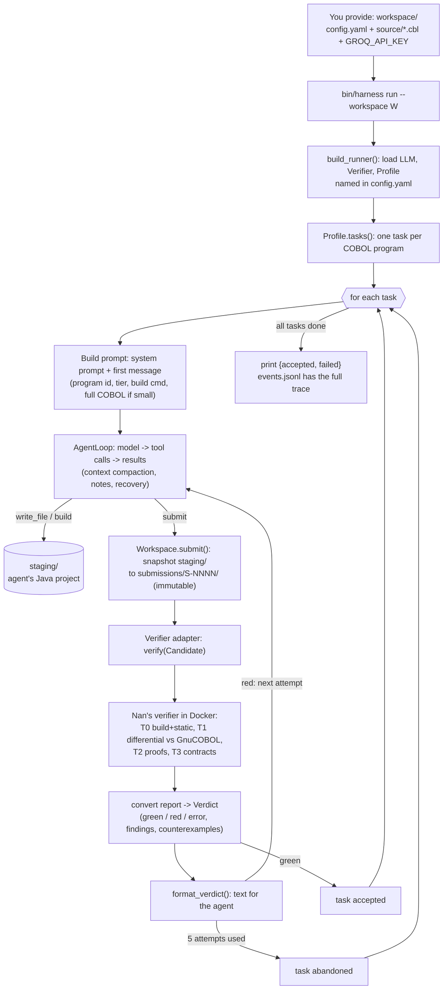

# The migration harness, end to end

*What happens from "here is a COBOL program" to "the verifier accepted the Java", what is implemented today, and what we still need.
Describes the code on the `integration` branch as of 11 Nov 2026 (modules `harness/`, `adapters/`, `extras/`, plus Nan's `verifier/`).*

## 0. In one paragraph

You give the harness a **workspace** (a folder with the COBOL source and a `config.yaml`) and run one command. For each COBOL program the
harness starts an **LLM agent** with a short prompt and a few tools (read/search the COBOL, write Java files, build, submit). When the agent
calls `submit`, the harness freezes a copy of its Java project and hands it to an **independent verifier** (Nan's), which compiles it and runs it
against the real COBOL (GnuCOBOL) on hundreds of generated inputs, and optionally proves things about it. The verifier's answer
(green/red, plus concrete failing inputs with expected vs actual output) is turned into text and fed back to the agent. The agent fixes
the code and submits again, until the verifier says green or the attempt budget (5) runs out. **The LLM never decides whether its code is correct; only the verifier does.**

## 1. The pipeline at a glance



## 2. What you provide

| Input | Where | Notes |
|---|---|---|
| COBOL programs | `workspace/source/*.cbl` (or `source.dir` / `source.entry` in config) | Files with a `PROCEDURE DIVISION` are programs; others are treated as copybooks and skipped. |
| Run settings | `workspace/config.yaml` | target language and build command, required tier, budgets, which adapters to use (see below). |
| LLM credentials | env `GROQ_API_KEY` (optional `HARNESS_MODEL`, `HARNESS_MAX_TOKENS`) | Only the Groq adapter exists today. |
| Verifier prerequisites | Docker image `cobol-verifier-toolchain:0.1.0`, venv `~/.venvs/cobol-verifier`, `runtimes/build/java/cobolrt.jar` | One-time setup: `make venv`, `make image`, `python3 -m tools.build_runtimes`. The image build needs network (GnuCOBOL, JBMC, OpenJML); on this machine we built it with the Go step removed since we are Java-only. |

Example `config.yaml` (this is what `integration/demo_workspace.py` generates):

```yaml
run:     {id: R-001}
source:  {dir: source}
target:  {language: java, version: "21", classpath: <path to cobolrt.jar>}   # build_cmd optional (default: javac everything)
gate:    {required_tier: tested}            # tested | bounded | proven  (decides which verifier tiers run)
budgets: {attempts_per_unit: 5, check_retries_on_error: 2}
harness:
  llm:      {adapter: harness.llm.groq:GroqLLM, model: openai/gpt-oss-20b}
  verifier: {adapter: adapters.verifiers.nan:NanVerifier}
  profile:  {adapter: extras.cobol_java:Profile}
  context:  {budget: 9000}                  # characters of history kept before old tool output is elided
```

There is no separate "spec" document: the specification the agent works from **is the COBOL source itself**, plus the conventions baked
into the translator prompt (section 4). The *oracle* is the same COBOL compiled with GnuCOBOL.

## 2.1 How the pieces are wired (the three modules)

| Module | Directory | Responsibility | Pluggable via |
|---|---|---|---|
| Harness | `harness/` | agent loop, tool registry, context management, workspace + submit, runner, events. No COBOL or verifier knowledge. | n/a (core) |
| Verifier adapters | `adapters/verifiers/` | turn "a submission snapshot" into "a Verdict". `ContractVerifier` = any checker following the agreement CLI; `NanVerifier` = glue over Nan's `verifier/`. | `harness.verifier.adapter` |
| Extras | `extras/cobol_java/` | what the COBOL->Java translator uses: task discovery, prompts, file + build tools. | `harness.profile.adapter` |
| (Nan's verifier) | `verifier/` | the actual formal/differential checking. Untouched. | called by `NanVerifier` |

## 3. Step by step

### Step 1: start
`bin/harness run --workspace W [--tasks DIVREM] [--max-steps 40]` runs `harness/cli.py`, which calls `config.build_runner()`.
It loads `config.yaml` (adding defaults: 5 attempts per task, 2 free verifier retries, required tier `tested`), creates `staging/`
and `runs/<run_id>/events.jsonl`, and instantiates the three adapters named in the config. `bin/harness tasks --workspace W` does the same
without an LLM and just lists the tasks.

### Step 2: find the tasks
`Profile.tasks()` scans `source/` for `.cbl/.cob/.cobol` files containing `PROCEDURE DIVISION`, reads `PROGRAM-ID`, counts lines, and makes one
`Task` per program (`id = PROGRAM-ID`, `scope = [id]`). Tasks run **sequentially in file-name order**. There is no analysis, ordering by
dependencies, or "what to migrate" decision any more (that exploration was removed on purpose).

### Step 3: build the prompt (the "initial prompt")
Two messages are sent for each task, both produced by `extras/cobol_java/prompts.py`:

1. **System prompt**: role ("translate ONE whole COBOL program to Java 21"), the workflow (read COBOL, `write_file`, `build`, fix, `submit`; only the
   verifier decides correctness; on RED read the counterexample and resubmit), and the **Java conventions** the verifier relies on:
   - one public class per program named `PascalCase(PROGRAM-ID)` with `main`; running `main` must reproduce stdout bytes, files written and exit code;
   - one method per paragraph, `camelCase(paragraph)`, same control flow; one field per data item, `camelCase(name)`;
   - decimals as scaled `long` or `BigDecimal` with explicit PIC truncation, never `float/double`; no clock/network/random; no hard-coded outputs;
   - COBOL semantics to respect: silent high-order truncation without `ON SIZE ERROR`, truncation vs `ROUNDED` (half away from zero),
     unsigned fields keep magnitude, DISPLAY zero-padding and sign characters;
   - file location `src/main/java/app/<ClassName>.java`.
   The system prompt also carries the agent's **notes** (re-read from disk every turn, see step 4).
2. **First user message**: program id, file, line count, required tier, the build command, and **the full COBOL source with line numbers** if the
   program is at most 220 lines; otherwise it tells the agent to read the file in chunks with `read_lines`.

### Step 4: the agent loop (`harness/loop.py`)
Each iteration sends the conversation plus tool schemas to the model and executes whatever tool calls come back. Things the loop handles:

- **Tools** (all go through `ToolRegistry`, which drops stray arguments, turns exceptions into `ERROR:` text for the model, and clips output to 5000 chars):

  | Tool | From | What it does |
  |---|---|---|
  | `list_files`, `read_file`, `read_lines`, `search` | extras `FilesPack` | look at the COBOL (read-only) and the agent's own project |
  | `write_file` | extras `FilesPack` | write into `staging/` only (paths cannot escape it) |
  | `build` | extras `BuildPack` | run `target.build_cmd` (default: `javac` all `.java`) in `staging/`, return compiler output |
  | `notes` | harness | append to / read a per-task scratchpad that is re-injected into the system prompt every turn |
  | `submit` | harness | snapshot + verify + return feedback (step 5) |

- **Context management** (`harness/context.py`): once the history exceeds the character budget (default 36,000; 9,000 in the demo config),
  old tool results and large tool-call arguments are replaced with short "[elided ...]" stubs. Messages are shrunk, never deleted, so every
  tool call keeps its matching result; the last 5 to 8 messages and the task message stay intact. `notes` survives because it lives in the system prompt.
- **Recovery**: if the model emits malformed tool JSON (a recoverable `LLMError`), the loop tells it and retries (up to 6 times); if it replies with plain text it
  is nudged to use tools (up to 3 times, then the task is abandoned as `gave_up`); other LLM errors (rate limits after retries, etc.) abandon the task.
- **Budgets**: at most 40 model calls per task (`--max-steps`) and 5 `submit` calls per task (`budgets.attempts_per_unit`), whichever comes first.
- **Events**: `llm_usage` (tokens in/out), `context_compacted`, `unit_started`, `unit_abandoned` are appended to `runs/<id>/events.jsonl`.

### Step 5: `submit`: snapshot, verify, feedback
1. `Workspace.submit()` allocates `submissions/S-NNNN/` (by `mkdir`), copies `staging/` to `S-NNNN/project/`, and writes `submission.json` last
   (scope = the task's program id, regression ids = programs already accepted in this run, required tier, attempt number). Emits `submission_created`.
   The snapshot is immutable, so the agent can keep editing while a check runs and every report points at exact code.
2. The runner builds a `Candidate` and calls `verifier.verify(candidate)`. `NanVerifier` runs `adapters/verifiers/nan/bin/phase2 check --workspace W --submission S`
   as a subprocess (under the verifier venv). If the verifier returns `error` (Docker down, tool crash) the runner retries the same
   snapshot, up to `check_retries_on_error` times, **without counting an attempt**.
3. The adapter (`adapters/verifiers/nan/adapter.py`) maps the contract onto Nan's API: it copies the project, turns `required_tier` into the
   tiers to run (`tested` = T0+T1, `bounded` = +T2, `proven` = +T3 in `full` mode), passes the previous attempt's verifier report so the
   random test inputs change every iteration (anti-overfitting) and the feedback gets a "what improved/regressed" section, and calls
   `verifier.api.verify(...)`.
4. `convert.py` translates Nan's report into the agreement's report (`reports/S-NNNN/report.json`) and the harness reads it as a `Verdict`
   (see the mapping below).
5. `format_verdict()` renders the verdict as text: verdict, summary, then per blocker: category, message, Java location, **counterexample
   (inputs, expected, actual)**, related gap ids, and a reproduce command. That text is the tool result the model sees.

### Step 6: what the verifier actually does (Nan's `verifier/`)
Real COBOL (GnuCOBOL 3.2, in the Docker image) is always the judge, never the Java. In `fast` mode (used for `tested`/`bounded`) the budget is about a minute for a
300-500 line program; we measured 14 s for the 124-line DIVREM.

| Tier | What it checks | Notes |
|---|---|---|
| **T0** | Java compiles; static rules (no `double` fields for decimals, no network/clock, no hard-coded outputs, no swallowed exceptions, no copying earlier counterexamples) | build or rule failures become `build_error` / `lint` findings |
| **T1** | runs COBOL and Java on generated inputs (boundary + literal-seeded + capped random sample, about 150 in fast mode) and compares stdout bytes, files written and return code | a mismatch is shrunk to a minimal counterexample, which becomes the agent's feedback. Needs paragraph coverage of at least 0.8 to accept. |
| **T2** | T2a: try every input if the domain is small (a real proof). T2b: JBMC bounded/complete proof that one COBOL paragraph equals its Java method, with vacuity checks | only some paragraphs are eligible (no I/O, no variable multiply/divide, no String/BigDecimal fields) |
| **T3** | OpenJML contracts derived from the COBOL (ranges, frame, exact result) | works on suitable paragraphs; some time out |

Verifier "level" to our tier: T3, T2a or a complete T2b = `proven`; a T2b with a bound = `bounded`; T0+T1 pass = `tested`; otherwise `unchecked`.
A task is **green** only if every paragraph in scope is accepted by the verifier's policy *and* reached the required tier, with no blocker findings.
Because T1 runs the whole program, one program-level failure shows up on every paragraph; the adapter collapses it into a single finding.

### Step 7: loop or stop
- **Green:** the task is marked accepted (added to the list of regression ids for later tasks) and the runner moves to the next program.
- **Red:** the agent reads the feedback and continues in the same conversation (same context, notes intact), usually `write_file` -> `build` -> `submit`.
- **Out of budget** (5 submits, 40 model calls, repeated text replies, or an unrecoverable LLM error): `unit_abandoned` is logged and the task counts as failed.
- After the last task the CLI prints `{"accepted": [...], "failed": [...]}`. **That is where the pipeline ends today.**

## 4. What exists on disk after a run

```
workspace/
  config.yaml        your settings
  source/            COBOL (read-only)
  staging/           the agent's Java project (shared across all tasks in the run)
  submissions/S-NNNN/{submission.json, project/}      immutable snapshot per submit
  reports/S-NNNN/report.json                           the Verdict source (agreement format)
  reports/S-NNNN/artifacts/verifier/                   Nan's raw output: report.json, summary.md, feedback/, cases/ (replayable)
  runs/R-001/events.jsonl                              trace: llm_usage, context_compacted, submission_created,
                                                       check_started/finished, unit_started/abandoned
  runs/R-001/notes/<PROGRAM>.md                        the agent's scratchpad
```

## 5. What is implemented vs not

| Area | Status |
|---|---|
| Agent loop, tool registry, context compaction, notes, malformed-output recovery | Done, unit tested (15 tests, no LLM/Docker needed) |
| Pluggable LLM / verifier / profile via `config.yaml` | Done |
| Submit semantics (immutable snapshot, `submission.json` last) and report contract | Done |
| Real verifier integration, red then green loop | Done and demonstrated end to end (DIVREM: seeded truncation bug -> red with counterexample -> fixed -> green, 7/7 paragraphs) using a **scripted** model |
| Free retries when the verifier itself errors; anti-overfitting seed rotation | Done |
| Real LLM driving the whole loop | **Partial.** Real Groq models called tools and wrote Java into staging, but never completed a submit: free-tier token limits (200k/day, tiny per-minute caps) and weak tool-calling in small models got in the way |
| Tiers above `tested` | Wired (`bounded`/`proven` select T2/T3, `full` mode) but **never exercised on real agent output**; the T2/T3 failure-to-finding path is only tested with a hand-made report |
| Final combined check and promotion to `accepted/` (agreement section 8) | **Not implemented** |
| `state.json`, `summary.json`, metrics (build rate, attempts to green, tokens per task, failure categories) | **Not implemented.** The raw events exist; nothing aggregates them |
| Contract JSON Schemas + `contracts validate`; Phase 2 `--stub` | **Not implemented** |
| Multi-program repos: ordering by dependencies, cross-program `CALL`, skipping unsupported programs (SQL/CICS) | **Not implemented.** Tasks are independent and alphabetical; the verifier will mark SQL/CICS programs out of scope |
| Pre-migration exploration / knowledge base / hazard hints | **Removed on purpose** (history keeps it: `git show 1f52012:phase1/phase1/cobol/analyzer.py`) |
| Checkpoint/resume, task decomposition, sub-agents | Deferred by design |

## 6. What we need going forward (suggested order)

1. **Get one real-LLM run all the way to green.** Needs a model with reliable tool calling and enough quota (a paid Groq tier or another provider via a new
   `LLM` adapter, about 30 lines). Until this works we cannot say anything about agent quality. Also try a larger first-prompt budget, since
   the small-model limits forced a stripped-down setup.
2. **Close the pipeline: final step + metrics.** After all tasks: a final combined verification of everything accepted (catches interactions), promote the last
   green snapshot to `accepted/`, write `summary.json` computed from `events.jsonl` and the reports. This is also what the evaluation side needs
   (build rate, attempts to green, tier distribution, failure categories, tokens and time per task).
3. **Make evaluation runnable.** The proposal's comparisons (full harness vs ablations such as no counterexamples / no hints, vs one-shot and mini-SWE baselines)
   need config switches in the harness (e.g. a toolset or feedback-detail toggle in the profile) and a runner that executes N programs x seeds and
   emits the logs. Real logs should go to `eval/runs/` in whatever format the eval side agrees on.
4. **Exercise `bounded`/`proven`.** Run with `gate.required_tier: proven` on corpus programs, see how often paragraphs are eligible and how the T2/T3 findings read to the agent. Expect
   many units to stay at `tested` (Nan's own results: 18 of 101 paragraphs reach level 2+).
5. **Multi-program handling.** Dependency-aware ordering, skipping or flagging programs the verifier cannot handle (SQL, CICS, indexed files), and per-task build isolation
   (today `staging/` is shared, so a broken later program breaks the build for everything already accepted).
6. **Sandbox the agent's `build` tool.** It currently runs `javac` on the host; the verifier's own execution is sandboxed (Docker, no network), ours is not.
7. **Optional re-adds, if they prove useful in ablations:** pre-migration analysis (call graph, hazard hints) as a *separate* tool pack/profile so it can be switched on and off for experiments.
8. **Contract hygiene:** JSON Schemas for submission/report/events with a validator, and a stub verifier so the harness can be tested without Docker.

## 7. Known limitations and risks to keep in mind

- The oracle is GnuCOBOL, so "correct" means "matches GnuCOBOL", not the mainframe compiler.
- T1 is testing, not proof: bugs on inputs never generated can slip through. The verifier's own self-test caught 71% of planted bugs (below its 90% target), and all of those catches came from T1.
- Whole-program differential testing means a program must be translated completely before it can pass; there is no partial credit per paragraph in the loop.
- Cost and speed: each attempt costs one verifier run (about 15 s for a small program, minutes with proofs) plus the LLM calls.
- Model-facing details matter a lot for small models: tool-schema size, prompt size, and output token caps decided whether a run could even start.

## 8. Quick reference

```bash
# one-time
make venv && make image && python3 -m tools.build_runtimes
# no LLM: list tasks / run unit tests / end-to-end with a scripted model
bin/harness tasks --workspace W
python3 -m unittest discover -s tests/harness -t .
python3 integration/e2e_scripted.py /some/dir          # needs Docker image + venv
# with an LLM
export GROQ_API_KEY=... HARNESS_MODEL=openai/gpt-oss-20b
python3 integration/demo_workspace.py W divrem --empty # sample workspace from the corpus
bin/harness run --workspace W --tasks DIVREM
# inspect a verifier failure
cat W/reports/S-0001/report.json ; cat W/reports/S-0001/artifacts/verifier/summary.md
```

Module READMEs: `harness/README.md`, `adapters/README.md`, `adapters/verifiers/nan/README.md`, `extras/README.md`. Interface details for the verifier: `docs/INTERFACE.md`; its results and limits: `docs/RESULTS.md`, `docs/LIMITATIONS.md`.
